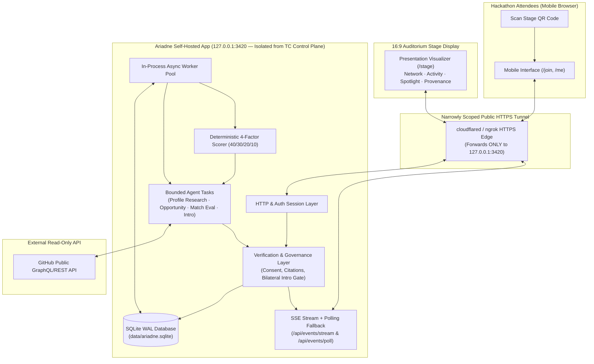

# Architecture Specification & ADRs — ARIADNE (`ARIADNE-HACK-2026`)
*Amended: Web-Only Self-Hosted Hackathon MVP*

## 1. Executive Architecture Specification

### Core Stack: **Single Self-Hosted Node.js (`v22.22.3`) Web Application + SQLite (`WAL` Mode) + In-Process Bounded Async Workers + SSE with Polling Fallback + Narrow Public HTTPS Tunnel**

Superseding earlier cloud/Discord/Medusa designs, Ariadne runs as a **single, self-hosted web application on the TangleClaw host (`cursatory`), strictly isolated from the TangleClaw control plane**:
1. **Two Interfaces Served by One Backend (`127.0.0.1:3420`):**
   - **Mobile Participant Interface (`/join`, `/me`, `/me/matches/:id`):** QR onboarding, GitHub identity submission, consent controls, live research progress, top-3 match results with 40/30/20/10 breakdown, `Interested`/`Pass` decisions, and mutually approved private web introductions.
   - **Presentation Visualizer (`/stage`):** Full-screen `16:9` (`1920x1080`) live network graph, participant activity feed, agent analysis states, evidence-backed connections, and introduction status. Operator-controlled with privacy-safe pseudonymous defaults (`Thread-XXXX`).
2. **SQLite (`WAL` Mode) Persistence:**
   - Single-file local database (`data/ariadne.sqlite` with `PRAGMA journal_mode = WAL; PRAGMA synchronous = NORMAL; PRAGMA busy_timeout = 5000;`) using Node.js `v22.22.3` (`better-sqlite3` or built-in `node:sqlite`).
   - Zero external cloud database provisioning, zero network latency on reads/writes, and instant file-copy snapshots at every Train boundary (`v0.1.0`, `v0.2.0`, `v0.3.0`, `v1.0.0`).
3. **In-Process Asynchronous Worker Queue (`async_jobs` table):**
   - HTTP intake (`POST /api/participants`) writes the participant row and enqueues a job in SQLite in `< 15ms`, returning immediately to the mobile browser.
   - An in-process bounded worker loop claims pending jobs (`status = 'queued'`), executes bounded GitHub API retrieval and structured AI agent evaluation with strict timeouts (`10s` GitHub / `12s` AI), writes results to SQLite, and emits live events.
4. **Live Browser Updates via SSE + Reconnect/Polling Fallback:**
   - Primary: `GET /api/events/stream?after=<seq_id>` (Server-Sent Events with `Last-Event-ID` automatic replay from SQLite `domain_events`).
   - Fallback: `GET /api/events/poll?after=<seq_id>` (JSON catch-up endpoint automatically polled every `3s` if cellular/venue proxies buffer SSE streams).
5. **Narrowly Scoped Public HTTPS Tunnel:**
   - Local server binds strictly to `127.0.0.1:3420` (registered in TangleClaw PortHub).
   - Exposed publicly via `/opt/homebrew/bin/cloudflared tunnel --url http://127.0.0.1:3420` (or named Cloudflare/ngrok tunnel pointing **solely** to `127.0.0.1:3420`).
   - **Strict Isolation Invariant:** The tunnel forwards only to `127.0.0.1:3420`. TangleClaw's control plane (`:3102`, `:3100`, `:8443`), agent terminals, and internal Medusa ports (`:3009`, `:3010`) are never reachable from the public tunnel.
6. **Zero External Messaging Dependencies in MVP:**
   - Discord, Medusa, and Morpheus integrations are removed from the hackathon critical path and placed on the post-hackathon roadmap.

---

## 2. System Topology

---

## 3. Architecture Decision Records (ADRs)

### ADR-A: Self-Hosted Web Application & Dual Interfaces
- **Decision:** Single TypeScript/Node.js web application serving both the mobile participant interface (`/join`, `/me`, `/me/matches/:id`) and the `16:9` presentation visualizer (`/stage`, `/provenance`).
- **Licensing Note:** Repository licensing remains deferred (`UNLICENSED` / TBD placeholder until Operator decides).
- **Session Isolation:** Each participant receives a cryptographically signed `HttpOnly`, `Secure`, `SameSite=Lax` cookie (`ariadne_session`) bound to their isolated `participant_id`.

### ADR-B: GitHub Intelligence (`src/lib/github/*`)
- **Decision:** Bounded single-flight fetcher using server-side `ARIADNE_GITHUB_TOKEN` (`5,000 req/hr`) with SQLite snapshot caching (`github_snapshots`, 30-minute TTL).
- **Scope:** Strictly public endpoints; zero private repo scopes; hard `10s` timeout; HTML/markdown sanitization before storage or prompt construction.

### ADR-C: Participant Intelligence & Epistemic Labeling (`src/lib/intelligence/*`)
- **Decision:** Store every capability and project need in SQLite with explicit `epistemic_type` (`SELF_REPORTED`, `OBSERVED_FACT`, `AI_INFERENCE`), `confidence` (`0.0–1.0`), `uncertainty_note`, and foreign-key links to `evidence_receipts`.

### ADR-D: Bounded Asynchronous Agent Workers (`src/lib/agents/*`)
- **Decision:** Run Profile Research, Opportunity Discovery, Match Evaluation, and Introduction Writer as bounded asynchronous tasks invoked by the in-process SQLite job worker, guarded by a deterministic Verification Layer (`verifyAndGovern`) and backed by a deterministic heuristic fallback if an LLM call times out.

### ADR-E: Event System (`SSE` + Polling Fallback) (`src/lib/events/*`)
- **Decision:** Append-only `domain_events` table in SQLite (`seq_id INTEGER PRIMARY KEY AUTOINCREMENT`). Clients subscribe via `GET /api/events/stream?after=<seq_id>` and automatically fall back to `GET /api/events/poll?after=<seq_id>` if an intermediate proxy drops chunked streams.

### ADR-F: Web-Native Mutual Introductions (Superseding Discord/Medusa MVP)
- **Decision:** All match proposals (`Interested` / `Pass`) and mutually approved introductions happen directly inside the mobile web application (`/me/matches/:id`). When both verified participants approve, Ariadne unlocks their shared **Mutual Introduction Room** containing verified GitHub links, optional user-supplied contact notes/handles, cited repositories, and a copyable collaboration icebreaker.
- **Post-Hackathon Roadmap:** Discord bot notifications, Medusa A2A negotiation, and Morpheus integration are deferred to post-hackathon versions.

### ADR-G: PortHub Reservations & Control-Plane Isolation
- **Decision:** Reserve local ports in TangleClaw PortHub before binding:
  - `3420` (`loopback` + narrow tunnel target): Ariadne Production/Demo Server
  - `3421` (`loopback`): Ariadne Integration / Test Server
  - `4420` (`loopback`): Automated Test Runner
- Zero routes, environment variables, or file paths from TangleClaw (`:3102`, `:3100`, `:8443`) or Medusa (`:3009`, `:3010`) are mounted or referenced by the Ariadne process.
