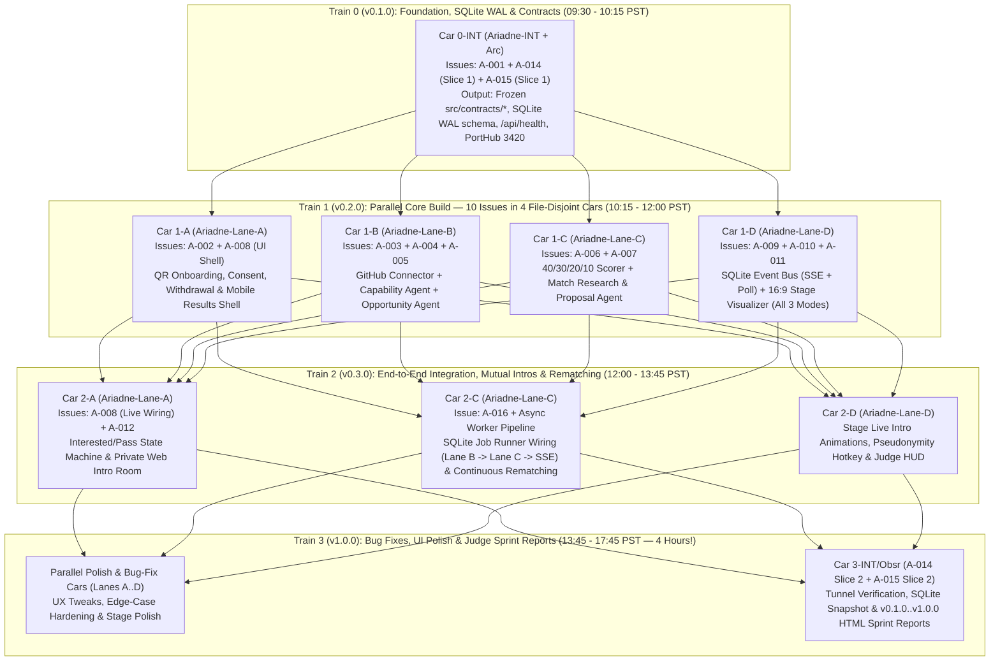

# Dependency DAG, Release Trains & Bundled Cars Plan — ARIADNE (`ARIADNE-HACK-2026`)
*Amended: Web-Only MVP + TC-Lane-PM Multi-Issue Car Bundling (`Rule #294`)*

## 1. Why Multi-Issue Bundled Cars Beat Single-Issue Waves

Per advisory consultation with `TC-Lane-PM` (`Rule #294` — *Single-Wave Multi-Issue Builder Car Bundling*):
- With Discord (`A-013`) and Medusa (`A-017`) moved to the post-hackathon roadmap, the Ariadne MVP consists of **15 issues** (`A-001`..`A-012`, `A-014`..`A-016`).
- Dispatching 15 individual single-issue PRs would cost ~3 hours in PR review queues, branch resets, and cross-lane rebases.
- Instead, we freeze `src/contracts/*` and `src/db/schema.ts` in **Train 0 (`v0.1.0` at 10:15 AM)**, and then bundle co-located issues per Builder lane into **File-Disjoint Multi-Issue Cars** so **all 4 Builders execute simultaneously in Train 1 (`v0.2.0`)**, landing **10 of the 15 MVP issues by 12:00 PM PST** and completing the entire functional MVP in **Train 2 (`v0.3.0`) by 13:45 PM PST**—leaving **4 full hours (`13:45–17:45 PST`)** for bug fixes, UI tweaks, live dogfooding, and Judge Sprint Reports!

---

## 2. Four-Train Dependency & Car Execution Graph

---

## 3. Train-by-Train Car Allocation & File-Disjoint Envelopes

| Train / Version | Window (PST) | Car ID | Lane | Bundled Issues | Exclusive File Write Envelope |
|---|---|---|---|---|---|
| **Train 0 (`v0.1.0`)** | `09:30–10:15` | **`Car 0-INT`** | `Ariadne-INT` *(+ `Arc`)* | `A-001`, `A-014` (S1), `A-015` (S1) | `package.json`, `src/contracts/*`, `src/db/*`, `src/app/api/health/*`, `docs/provenance/*`, `changelog.d/A-001.md` |
| **Train 1 (`v0.2.0`)** | `10:15–12:00` | **`Car 1-A`** | `Ariadne-Lane-A` | `A-002`, `A-008` (Shell) | `src/app/join/*`, `src/app/me/*`, `src/app/api/participants/*`, `src/app/api/auth/*`, `tests/lane-a/*`, `changelog.d/A-002.md` |
| **Train 1 (`v0.2.0`)** | `10:15–12:00` | **`Car 1-B`** | `Ariadne-Lane-B` | `A-003`, `A-004`, `A-005` | `src/lib/github/*`, `src/lib/agents/profile-research.ts`, `src/lib/agents/opportunity-discovery.ts`, `tests/lane-b/*`, `changelog.d/A-003-004-005.md` |
| **Train 1 (`v0.2.0`)** | `10:15–12:00` | **`Car 1-C`** | `Ariadne-Lane-C` | `A-006`, `A-007` | `src/lib/scoring/*`, `src/lib/agents/match-evaluator.ts`, `src/lib/agents/intro-writer.ts`, `tests/lane-c/*`, `changelog.d/A-006-007.md` |
| **Train 1 (`v0.2.0`)** | `10:15–12:00` | **`Car 1-D`** | `Ariadne-Lane-D` | `A-009`, `A-010`, `A-011` | `src/lib/events/*`, `src/app/api/events/*`, `src/app/stage/*`, `src/components/stage/*`, `tests/lane-d/*`, `changelog.d/A-009-010-011.md` |
| **Train 2 (`v0.3.0`)** | `12:00–13:45` | **`Car 2-A`** | `Ariadne-Lane-A` | `A-008` (Live), `A-012` | `src/app/me/*`, `src/app/api/matches/*`, `src/lib/intros/*`, `tests/lane-a/intros.test.ts`, `changelog.d/A-008-012.md` |
| **Train 2 (`v0.3.0`)** | `12:00–13:45` | **`Car 2-C`** | `Ariadne-Lane-C` | `A-016` + Worker | `src/lib/jobs/*`, `src/lib/scoring/rematcher.ts`, `src/app/api/worker/*`, `tests/lane-c/rematcher.test.ts`, `changelog.d/A-016.md` |
| **Train 2 (`v0.3.0`)** | `12:00–13:45` | **`Car 2-D`** | `Ariadne-Lane-D` | Stage Wiring & Polish | `src/app/stage/*`, `src/components/stage/*`, `src/app/reports/*` |
| **Train 3 (`v1.0.0`)** | `13:45–17:45` | **`Car 3-*`** | All Lanes + `Obsr`/`INT` | `A-014` (S2), `A-015` (S2), Polish & Bug Fixes | Disjoint polish assignments + `docs/reports/v0.1.0..v1.0.0/index.html` (`Sprint Reporting Standard v2.0.0`) |

---

## 4. Zero-Collision Shared-File Prevention Rules

1. **Frozen Root & Contracts after `v0.1.0`:** No Builder lane (`Lane-A`..`D`) ever modifies `package.json`, `tsconfig.json`, `src/contracts/*`, or `src/db/schema.ts`.
2. **Changelog Fragments (`changelog.d/<issue>.md`):** Builders never edit root `CHANGELOG.md` on feature branches. Each Car writes its entry to `changelog.d/<car-issues>.md`, and `Ariadne-INT` compiles root `CHANGELOG.md` during each Train release cut (`v0.1.0`, `v0.2.0`, `v0.3.0`, `v1.0.0`).
3. **Pre-Flight Architect Ruling (`A-Gate`):** Before `Ariadne-PM` dispatches any Car, `Ariadne-Arc` posts the exact exported function names and file write envelope on the issue(s), enabling same-wave file-disjoint merging without ancestor rebases.
