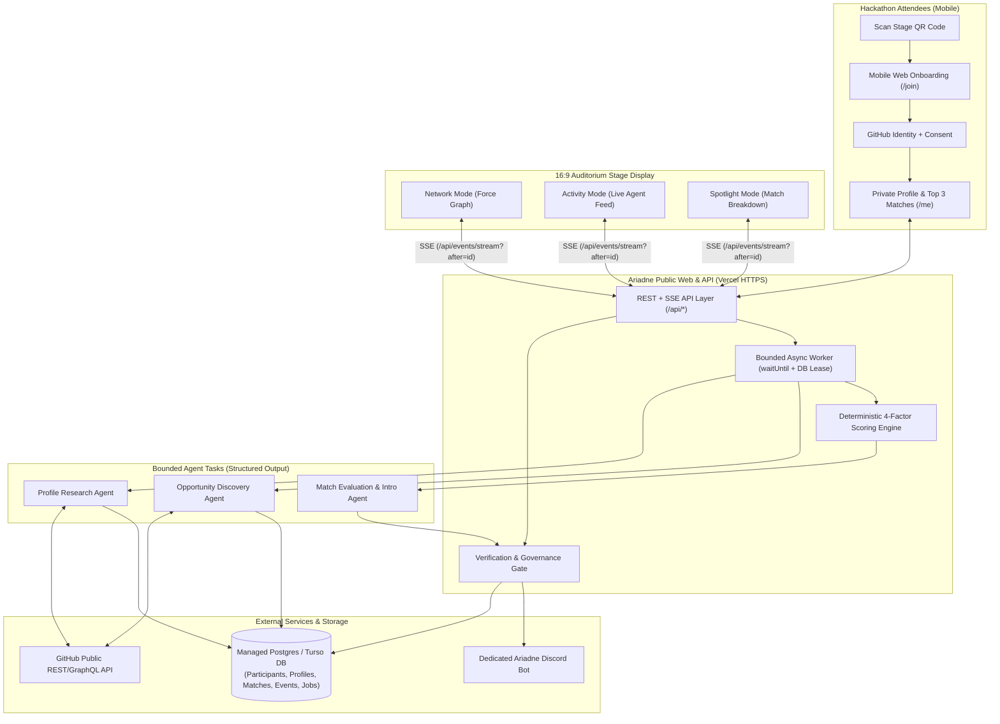

# Architecture Specification & ADRs — ARIADNE (`ARIADNE-HACK-2026`)

## 1. Executive Architecture Recommendation

### Recommended Stack: **Next.js (App Router, TypeScript) on Vercel + Neon Serverless Postgres (or Turso/libSQL) + In-App Bounded Async Job Runner (`waitUntil` + DB-Backed Job Queue)**

Why this is the highest-probability H-Day architecture:
1. **Already Authenticated on Host:** Read-only preflight confirmed `vercel` CLI is installed and authenticated as `jason-vaughan`, `gh` CLI is authenticated as `Jason-Vaughan`, and `node v22.22.3` is active. Zero time lost setting up new cloud vendors on Saturday morning.
2. **Single-Repo, Multi-Worktree Friendly:** Next.js App Router cleanly separates UI routes (`src/app/(public)/*`, `src/app/stage/*`), API routes (`src/app/api/*`), and domain modules (`src/lib/github/*`, `src/lib/agents/*`, `src/lib/scoring/*`, `src/lib/events/*`) so 4 parallel TangleClaw Builders can work in isolated Git worktrees without stepping on shared files.
3. **Zero-Config Public HTTPS + Instant Rollback:** Every merged PR to `main` automatically deploys to a public HTTPS URL with instant 1-click rollback in Vercel if a late merge introduces a regression before the 6:00 PM judging freeze.
4. **Reliable Background Execution Without Extra Infra:** Using a DB-backed `jobs` table triggered via Vercel's `waitUntil()` (with an idempotent `/api/worker/tick` fallback endpoint polled every 5s by the stage visualizer or cron) guarantees asynchronous GitHub research and LLM evaluation complete reliably within a 60s function budget without managing a separate Redis/BullMQ cluster.

### Tradeoff Comparison Matrix

| Criterion | **Option A (RECOMMENDED): Vercel + Managed Serverless DB (Neon/Turso) + `waitUntil` DB Worker** | **Option B: Vercel + Separate Dedicated Worker Host + Redis Queue** | **Option C: Single Independently Hosted Node VM (Railway/Fly + SQLite)** |
|---|---|---|---|
| **Host Readiness** | **High** (`vercel` CLI already logged in as `jason-vaughan`) | **Medium** (Requires provisioning 3 separate services + cross-service auth) | **Low** (`railway` and `flyctl` CLIs are not installed on host) |
| **Time to First Deploy** | **< 5 minutes** | 25–40 minutes | 20–30 minutes |
| **Parallel Fleet Ergonomics** | **Excellent** (Single TypeScript build/test pipeline across worktrees) | **Moderate** (Split repo or monorepo deployment coordination) | **Good** |
| **Live Event Streaming** | **SSE + DB cursor (`Last-Event-ID`)** — works statelessly across serverless instances | WebSockets or SSE via Redis PubSub | In-memory EventEmitter + SSE |
| **Isolation from TangleClaw Host** | **100% Isolated** (Public traffic hits Vercel edge, never `cursatory` loopback) | **100% Isolated** | **100% Isolated** |
| **Instant Rollback** | **Built-in** (`vercel rollback`) | Requires coordinating web + worker rollbacks | Manual container redeploy |

---

## 2. System Topology

---

## 3. Architecture Decision Records (ADRs)

### ADR-A: Public Web Application (`src/app/*`)
- **Decision:** Next.js App Router with Tailwind CSS and Lucide icons; mobile-first viewport (`max-w-md mx-auto`) for `/join` and `/me`, and full-bleed `1920x1080` responsive canvas/SVG layout for `/stage`.
- **Licensing Note:** Per Operator directive, GitHub repository licensing is deferred (`UNLICENSED` / TBD placeholder until Operator decides).
- **Session Model:** Signed `HttpOnly` cookie (`ariadne_session`) linked to `participants.id` + `consent_status`.

### ADR-B: GitHub Intelligence (`src/lib/github/*`)
- **Decision:** Bounded single-flight fetcher using an authenticated GitHub Personal Access Token / GitHub App installation token (`5,000 req/hr` REST + GraphQL) with ETag/DB caching (`github_snapshots` table, 30-minute TTL).
- **Scope:** Strictly public endpoints (`/users/:username`, top 8 non-fork repositories by recent push + stars, `README.md` truncated to 4,000 chars, language breakdown, up to 10 recent public issues/PRs authored or open in active repos).
- **Guardrails:** Hard timeout of `10s` per GitHub fetch batch; zero scraping; zero recursive tree traversal; untrusted markdown sanitized before rendering or prompt injection.

### ADR-C: Participant Intelligence Model (`src/lib/intelligence/*`)
- **Decision:** Every profile claim is stored as an atomic record with an explicit `epistemic_type`:
  - `SELF_REPORTED`: Explicitly entered or toggled by the participant.
  - `OBSERVED_FACT`: Directly verifiable from GitHub metadata (e.g., *"Author of `repo-x` (TypeScript, 142 commits in last 90 days)"*).
  - `AI_INFERENCE`: Synthesized capability or project bottleneck (e.g., *"Open issue #12 suggests need for WebRTC NAT traversal expertise"*), always paired with `confidence` (`0.0–1.0`), `uncertainty_note`, and `evidence_urls[]`.

### ADR-D: Agentic Discovery & Matching (`src/lib/agents/*`)
- **Decision:** Implement the 4 agent roles as **bounded, stateless, schema-validated asynchronous task functions** (using structured JSON schema output and strict token/time budgets) coordinated by the Verification/Governance Layer:
  1. `runProfileResearchAgent(githubSnapshot)` → Produces grounded `CapabilityProfile`.
  2. `runOpportunityDiscoveryAgent(githubSnapshot, capabilityProfile)` → Produces `CandidateOpportunity[]`.
  3. `runMatchEvaluationAgent(profileA, profileB, scoreBreakdown)` → Evaluates top scored pairs and filters out superficial overlaps.
  4. `runIntroductionAgent(profileA, profileB, matchEvaluation)` → Generates the specific collaboration pitch and suggested first conversation.
  5. `verifyAndGovern(artifact, policyContext)` → Deterministic validator checking that every `evidence_url` belongs to the target participant's actual fetched snapshot, consent flags are valid, and bilateral approval exists before any introduction side effect.

### ADR-E: Event & Visualization System (`src/lib/events/*`)
- **Decision:** Append-only `domain_events` table with monotonic integer `seq_id`, UUID `event_id`, `event_type`, `created_at`, `actor_pseudonym`, `internal_payload` (private), and `public_payload` (sanitized at write-time by the Governance Layer).
- **Transport:** Server-Sent Events (`GET /api/events/stream?after=<seq_id>`) reading exclusively from `public_payload`. If a serverless SSE connection recycles after 30–60s, browser `EventSource` automatically reconnects with `Last-Event-ID` and replays missed events from Postgres without losing state or fabricating activity.

### ADR-F: Discord Integration (`src/lib/discord/*`)
- **Decision:** Dedicated standalone Discord Application (`Ariadne Matchmaker Bot`) using Discord REST API v10 (slash-command / button webhook interaction endpoint `/api/discord/interactions` or DM channel creation inside the event Discord server).
- **Isolation:** Completely separate from TangleClaw's Operator Discord bot.
- **Fallback:** Every match proposal and mutual introduction is first-class inside the private web UI (`/me/matches/:id`). If a participant does not use Discord or has DMs disabled, the web workflow completes 100% of the introduction without error.

### ADR-G: Medusa Coordination Adapter (`src/lib/medusa/*` — Optional / P2)
- **Decision:** Keep Medusa strictly off the critical path (tracked as `A-017`, P2 Optional).
- **Boundary:** Never expose Medusa's loopback port (`3009`/`3010`) or shared secret to the public web app. If `A-017` is activated during stretch window, it runs only as a local development/stage-telemetry bridge emitting anonymized match-negotiation summaries to TangleClaw's local switchboard.

### ADR-H: Local PortHub Reservations (For H-Day Local Dev & Testing)
- Per TangleClaw PortHub rules (`3200–3999` project services, `4000–4999` auxiliary), H-Day local development will register and use verified free ports:
  - `3420` (`loopback`): Ariadne Next.js Dev Server
  - `3421` (`loopback`): Ariadne Local Worker / Webhook Harness
  - `4420` (`loopback`): Vitest / Playwright Test Runner UI
