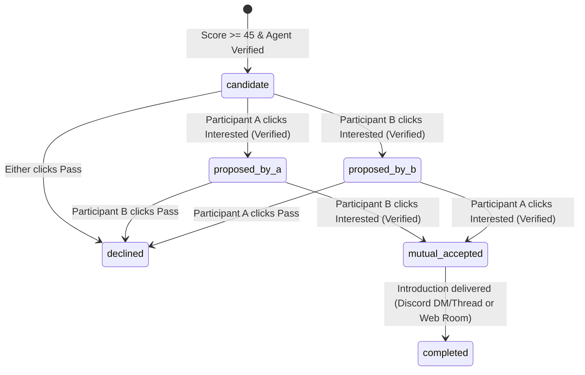

# Data & Events Contract Specification — ARIADNE (`ARIADNE-HACK-2026`)

> **Purpose:** Canonical interface contract for Issue `A-001`. All parallel H-Day lanes (Builder A: Onboarding/UI, Builder B: GitHub/Profile Intelligence, Builder C: Matching/Proposals, Builder D: Event Stream/Visualizer) must conform to these exact field names, enums, and state transitions.

---

## 1. Core Entity Contracts

### 1.1 `Participant`
| Field | Type | Description |
|---|---|---|
| `id` | `string (UUID)` | Primary key |
| `pseudonym` | `string` | Deterministic stage-safe handle (e.g., `Thread-7C4E`) |
| `github_username` | `string` | Normalized lowercase GitHub login |
| `github_user_id` | `number \| null` | Immutable GitHub numeric ID (populated on fetch/OAuth) |
| `ownership_verified` | `boolean` | `true` only after GitHub OAuth or challenge verification |
| `consent_status` | `'granted' \| 'withdrawn'` | Required before any GitHub fetch or matching |
| `consent_granted_at` | `ISO8601 string` | Timestamp of explicit opt-in |
| `public_display_consent` | `boolean` | Default `false`. If `true`, stage visualizer may show `github_username` & `avatar_url` |
| `discord_handle` | `string \| null` | Optional participant Discord username / user ID |
| `analysis_state` | `'registered' \| 'fetching_github' \| 'analyzing_profile' \| 'ready' \| 'failed' \| 'withdrawn'` | Current processing lifecycle state |
| `created_at` | `ISO8601 string` | Creation timestamp |
| `updated_at` | `ISO8601 string` | Last update timestamp |

---

### 1.2 `EvidenceReceipt`
Every capability claim, opportunity finding, and match explanation must reference one or more `EvidenceReceipt` records.
| Field | Type | Description |
|---|---|---|
| `id` | `string (UUID)` | Evidence receipt identifier |
| `participant_id` | `string (UUID)` | Owning participant |
| `source_type` | `'repo_metadata' \| 'readme_excerpt' \| 'commit_activity' \| 'open_issue' \| 'pull_request' \| 'user_profile'` | Category of public GitHub artifact |
| `source_url` | `string (HTTPS URL)` | Direct `https://github.com/...` permalink |
| `repo_full_name` | `string \| null` | e.g., `owner/repo` |
| `title_or_summary` | `string` | Sanitized plain-text title or excerpt (`<= 280 chars`) |
| `source_updated_at` | `ISO8601 string` | Timestamp from GitHub showing recency |
| `fetched_at` | `ISO8601 string` | Timestamp when Ariadne retrieved the record |

---

### 1.3 `CapabilityClaim`
| Field | Type | Description |
|---|---|---|
| `id` | `string (UUID)` | Claim identifier |
| `participant_id` | `string (UUID)` | Owning participant |
| `category` | `'language' \| 'framework' \| 'domain' \| 'systems_architecture' \| 'tooling'` | Capability taxonomy |
| `name` | `string` | Canonical capability label (e.g., `TypeScript`, `Distributed Consensus`, `WebRTC`) |
| `epistemic_type` | `'SELF_REPORTED' \| 'OBSERVED_FACT' \| 'AI_INFERENCE'` | Provenance classification |
| `proficiency_signal` | `'primary' \| 'active' \| 'exploratory'` | Depth indicator grounded in commit/repo volume |
| `confidence` | `number (0.0–1.0)` | Confidence score |
| `uncertainty_note` | `string \| null` | Required if `confidence < 0.75` or `epistemic_type === 'AI_INFERENCE'` |
| `evidence_receipt_ids` | `string[]` | Non-empty array of `EvidenceReceipt.id` values |
| `dismissed_by_user` | `boolean` | Default `false`. Participant can dismiss inaccurate inferences |

---

### 1.4 `OpportunityNeed`
| Field | Type | Description |
|---|---|---|
| `id` | `string (UUID)` | Opportunity identifier |
| `participant_id` | `string (UUID)` | Owning participant |
| `project_repo` | `string` | `owner/repo` where opportunity was detected |
| `opportunity_type` | `'open_issue_help' \| 'complementary_skill_gap' \| 'architecture_scaling' \| 'shared_research_domain'` | Classification |
| `label` | `'Potential Opportunity (AI Inference)' \| 'Participant Confirmed Need'` | Must default to `'Potential Opportunity (AI Inference)'` |
| `summary` | `string` | Concise description of the potential collaboration problem (`<= 240 chars`) |
| `desired_capabilities` | `string[]` | Canonical capability tags that would complement this opportunity |
| `confidence` | `number (0.0–1.0)` | Confidence indicator |
| `uncertainty_note` | `string` | Explicit caveat (e.g., *"Inferred from open issue #19 (45 days old); may not be an active blocker"*) |
| `evidence_receipt_ids` | `string[]` | Supporting GitHub issue/PR/README receipt IDs |
| `dismissed_by_user` | `boolean` | Default `false` |

---

### 1.5 `MatchCandidate` & `MatchProposal`
| Field | Type | Description |
|---|---|---|
| `id` | `string (UUID)` | Canonical match ID (ordered pair: `participant_a_id < participant_b_id`) |
| `participant_a_id` | `string (UUID)` | First participant |
| `participant_b_id` | `string (UUID)` | Second participant |
| `composite_score` | `number (0–100)` | Weighted heuristic score (`>= 45` required to surface) |
| `score_breakdown` | `ScoreBreakdown` | `{ complementary_skills: 0..40, project_relevance: 0..30, evidence_strength: 0..20, recency: 0..10 }` |
| `complementary_summary` | `string` | Why A and B complement each other |
| `relevant_projects` | `string[]` | Specific `owner/repo` names cited |
| `suggested_first_collaboration` | `string` | Concrete first 15-minute topic or co-hacking task |
| `confidence_limitations` | `string` | Honest disclosure of where evidence is thin or inferred |
| `evidence_receipt_ids` | `string[]` | Combined supporting evidence receipts from A and B |
| `intro_state` | `IntroductionState` | See Section 2 state machine |

---

## 2. Mutual-Introduction State Machine (`A-012`)

### State Invariants
1. **No Unverified Proposals:** Transition from `candidate` to `proposed_by_*` or `mutual_accepted` requires `participant.ownership_verified === true` (or explicit H-Day verified session token).
2. **Idempotency:** Repeated `POST /api/matches/:id/decision` calls with the same actor and decision return `200 OK` with current state and **never** emit duplicate `introduction.proposed` or `introduction.completed` events or duplicate Discord messages.
3. **Asymmetric Privacy:** While in `proposed_by_a`, Participant A sees *"Interest Sent — Waiting for response"*. If Participant B clicks **Pass** (`declined`), Participant A continues to see *"Pending / No mutual match yet"* rather than a hostile rejection alert.

---

## 3. Structured Event Stream Contract (`A-009`)

Every state transition writes a row to `domain_events` and broadcasts the sanitized `PublicEventEnvelope` over SSE (`GET /api/events/stream`).

### 3.1 `PublicEventEnvelope`
| Field | Type | Description |
|---|---|---|
| `seq_id` | `number` | Monotonically increasing cursor (`Last-Event-ID`) |
| `event_id` | `string (UUID)` | Unique event UUID |
| `event_type` | `EventType` | One of the 12 canonical event types below |
| `timestamp` | `ISO8601 string` | UTC emission time |
| `processing_state` | `'started' \| 'in_progress' \| 'completed' \| 'failed'` | Lifecycle indicator |
| `actor_display` | `PublicParticipantRef` | `{ pseudonym, display_name: string \| null, avatar_url: string \| null }` (populated *only* if `public_display_consent === true`) |
| `counterpart_display` | `PublicParticipantRef \| null` | Present on match/intro events (respecting counterpart's `public_display_consent`) |
| `public_payload` | `object` | Strictly sanitized display summary (zero private messages, zero tokens, zero unconsented handles) |

### 3.2 Canonical `EventType` Catalog
1. `participant.registered` — New consenting participant joined (`{ pseudonym, total_participants }`).
2. `github.fetch.started` — Bounded GitHub retrieval initiated (`{ pseudonym }`).
3. `github.fetch.completed` — Public repos/issues retrieved (`{ pseudonym, repo_count, evidence_count, duration_ms }`).
4. `profile.analysis.completed` — Capability profile extracted (`{ pseudonym, top_domains, observed_count, inferred_count }`).
5. `opportunity.identified` — Candidate project need discovered (`{ pseudonym, opportunity_type, domain_tags, confidence_tier }`).
6. `match.candidate.generated` — Heuristic scorer paired two profiles above threshold (`{ match_id, pseudonym_a, pseudonym_b, composite_score }`).
7. `match.evaluated` — Match Evaluation Agent verified collaboration thesis (`{ match_id, pseudonym_a, pseudonym_b, composite_score, shared_domains }`).
8. `introduction.proposed` — One participant expressed interest (`{ match_id, status: 'awaiting_mutual' }`).
9. `introduction.accepted` — Counterpart accepted (`{ match_id, pseudonym_a, pseudonym_b }`).
10. `introduction.declined` — Aggregate counter increment only (no pair details broadcast publicly on stage).
11. `introduction.completed` — Mutual introduction delivered via Discord/Web (`{ match_id, pseudonym_a, pseudonym_b, channel: 'discord' \| 'web' }`).
12. `analysis.failed` — Graceful failure telemetry (`{ pseudonym, stage, fallback_applied: boolean }`).
