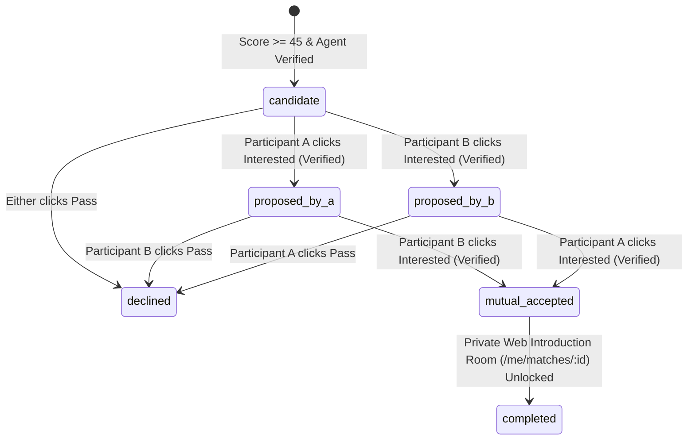

# Data & Events Contract Specification — ARIADNE (`ARIADNE-HACK-2026`)
*Amended: Web-Only Self-Hosted Hackathon MVP (SQLite WAL + SSE/Polling)*

> **Purpose:** Canonical interface contract for `Car 0-INT` (`A-001`). Once `v0.1.0` merges, `src/contracts/*` and `src/db/schema.ts` are **FROZEN** so all 4 Builder lanes (`Lane-A`..`D`) execute Train 1 (`v0.2.0`) 100% in parallel against deterministic contract fixtures.

---

## 1. Core SQLite Entity Contracts (`data/ariadne.sqlite`)

### 1.1 `Participant` (`participants` table)
| Field | Type | Description |
|---|---|---|
| `id` | `string (UUID)` | Primary key |
| `display_alias` | `string` | Deterministic stage-safe handle (e.g., `Thread-7C4E`; format `^[A-Z][a-z]{1,15}-[0-9A-F]{4}$`) |
| `github_username` | `string` | Normalized lowercase GitHub login |
| `github_user_id` | `number \| null` | Immutable GitHub numeric ID |
| `avatar_url` | `string \| null` | Public GitHub avatar URL |
| `ownership_verified` | `boolean` | `true` after GitHub OAuth or challenge verification |
| `consent_status` | `'granted' \| 'withdrawn'` | Required before any GitHub fetch or matching |
| `consent_granted_at` | `ISO8601 string` | Timestamp of explicit opt-in |
| `website_url` | `string (HTTPS URL) \| null` | Optional public personal website / portfolio (`A-002`, `A-003`) |
| `stage_display_consent` | `boolean` | Default `false`. If `true`, stage visualizer may show `github_username` & `avatar_url` |
| `contact_card` | `string \| null` | Optional private contact note/handle shared **only** upon bilateral `completed` introduction |
| `analysis_state` | `'registered' \| 'fetching_github' \| 'analyzing_profile' \| 'ready' \| 'failed' \| 'withdrawn'` | Current processing lifecycle state |
| `created_at` | `ISO8601 string` | Creation timestamp |
| `updated_at` | `ISO8601 string` | Last update timestamp |

---

### 1.2 `EvidenceReceipt` (`evidence_receipts` table)
| Field | Type | Description |
|---|---|---|
| `id` | `string (UUID)` | Evidence receipt identifier |
| `participant_id` | `string (UUID)` | Owning participant |
| `source_type` | `'repo_metadata' \| 'readme_excerpt' \| 'commit_activity' \| 'open_issue' \| 'pull_request' \| 'user_profile' \| 'public_website'` | Category of public artifact |
| `source_url` | `string (HTTPS URL)` | Direct `https://github.com/...` permalink (any HTTPS URL for `public_website`) |
| `repo_full_name` | `string \| null` | e.g., `owner/repo` |
| `title_or_summary` | `string` | Sanitized plain-text title or excerpt (`<= 280 chars`) |
| `source_updated_at` | `ISO8601 string` | Timestamp from GitHub showing recency |
| `fetched_at` | `ISO8601 string` | Timestamp when Ariadne retrieved the record |

---

### 1.3 `CapabilityClaim` (`capability_claims` table)
| Field | Type | Description |
|---|---|---|
| `id` | `string (UUID)` | Claim identifier |
| `participant_id` | `string (UUID)` | Owning participant |
| `category` | `'language' \| 'framework' \| 'domain' \| 'systems_architecture' \| 'tooling'` | Capability taxonomy |
| `name` | `string` | Canonical capability label |
| `epistemic_type` | `'SELF_REPORTED' \| 'OBSERVED_FACT' \| 'AI_INFERENCE'` | Provenance classification |
| `proficiency_signal` | `'primary' \| 'active' \| 'exploratory'` | Depth indicator grounded in commit/repo volume |
| `confidence` | `number (0.0–1.0)` | Confidence score |
| `uncertainty_note` | `string \| null` | Required if `confidence < 0.75` or `epistemic_type === 'AI_INFERENCE'` |
| `evidence_receipt_ids` | `string[] (JSON)` | Non-empty array of `EvidenceReceipt.id` values |
| `dismissed_by_user` | `boolean` | Default `false`. Participant can dismiss inaccurate inferences |

---

### 1.4 `OpportunityNeed` (`opportunity_needs` table)
| Field | Type | Description |
|---|---|---|
| `id` | `string (UUID)` | Opportunity identifier |
| `participant_id` | `string (UUID)` | Owning participant |
| `project_repo` | `string` | `owner/repo` where opportunity was detected |
| `opportunity_type` | `'open_issue_help' \| 'complementary_skill_gap' \| 'architecture_scaling' \| 'shared_research_domain'` | Classification |
| `label` | `'Potential Opportunity (AI Inference)' \| 'Participant Confirmed Need'` | Defaults to `'Potential Opportunity (AI Inference)'` |
| `summary` | `string` | Concise description (`<= 240 chars`) |
| `desired_capabilities` | `string[] (JSON)` | Canonical capability tags that complement this opportunity |
| `confidence` | `number (0.0–1.0)` | Confidence indicator |
| `uncertainty_note` | `string` | Explicit caveat (especially for issues `> 120 days` old) |
| `evidence_receipt_ids` | `string[] (JSON)` | Supporting GitHub receipt IDs |
| `dismissed_by_user` | `boolean` | Default `false` |

---

### 1.5 `MatchProposal` (`matches` table)
| Field | Type | Description |
|---|---|---|
| `id` | `string (UUID)` | Canonical match ID (`participant_a_id < participant_b_id`) |
| `participant_a_id` | `string (UUID)` | First participant |
| `participant_b_id` | `string (UUID)` | Second participant |
| `composite_score` | `integer (0–100)` | `compositeScore(score_breakdown)` (`>= 45` required to surface) |
| `score_breakdown` | `ScoreBreakdown (JSON)` | `{ capability_similarity, need_offer_fit, complementarity, novelty, freshness }`, each `0..1`, weighted `0.35/0.30/0.15/0.10/0.10` (`MATCH_SCORING_SPEC.md` §2) |
| `complementary_summary` | `string` | Why A and B complement each other |
| `relevant_projects` | `string[] (JSON)` | Specific `owner/repo` names cited |
| `suggested_first_collaboration` | `string` | Concrete first 15-minute conversation or co-hacking task |
| `confidence_limitations` | `string` | Honest disclosure of where evidence is thin or inferred |
| `evidence_receipt_ids` | `string[] (JSON)` | Combined supporting evidence receipts from A and B (at least 2 cited evidence pills) |
| `intro_state` | `IntroductionState` | `'candidate' \| 'proposed_by_a' \| 'proposed_by_b' \| 'mutual_accepted' \| 'completed' \| 'declined'` |
| `approval_a` / `approval_b` | `boolean` | Default `false`. Explicit approval by each participant; must agree with `intro_state` (e.g. `proposed_by_a` ⇒ `true`/`false`; `mutual_accepted`/`completed` ⇒ both `true`) |
| `shared_intro_notes` | `IntroRoomMessage[] (JSON)` | Lightweight shared web messages inside `/me/matches/:id` once `completed` |

---

## 2. Web-Only Mutual-Introduction State Machine (`A-012`)

### State Invariants
1. **Verified Ownership Required:** Transitioning to `proposed_by_*` or `mutual_accepted` requires `participant.ownership_verified === true`.
2. **Bilateral Approval:** Each edge belongs to one party — A proposes `proposed_by_a`, B proposes `proposed_by_b`, only the participant who did *not* propose may move to `mutual_accepted`, and only the system completes. `canTransitionIntroState(from, to, { side, verified })` enforces this; contact details are released only when `canRevealContact` holds (`completed` AND `approval_a` AND `approval_b`).
3. **Idempotent Decisions:** Repeated `POST /api/matches/:id/decision` calls with the same actor and decision return `200 OK` and never emit duplicate `introduction.proposed` or `introduction.completed` events.
4. **Web-Native Introduction Reveal:** Immediately upon `mutual_accepted` → `completed`, both participants' mobile browsers unlock `/me/matches/:id` showing both verified GitHub profiles, `contact_card` details, copyable collaboration starter, and a real-time shared note box.

---

## 3. Structured Event Stream & Polling Fallback Contract (`A-009`)

Every state transition inserts a row into SQLite `domain_events` (`seq_id INTEGER PRIMARY KEY AUTOINCREMENT`) and is served via:
- **SSE Stream:** `GET /api/events/stream?after=<seq_id>` (or `Last-Event-ID` header)
- **Polling Fallback:** `GET /api/events/poll?after=<seq_id>` → returns `{ events: PublicEventEnvelope[], latest_seq_id: number }`

Envelope: `{ seq_id, event_id, type, occurred_at, payload }` with a strict per-type payload (`src/contracts/events.ts`). Payloads identify participants by `display_alias` (pair events: `display_alias_a` / `display_alias_b`); GitHub identity appears only inside a `display` object carrying `stage_display_consent: true`.

### Canonical `EventType` Catalog
1. `participant.registered`
2. `github.fetch.started`
3. `github.fetch.completed`
4. `profile.analysis.completed`
5. `opportunity.identified`
6. `match.candidate.generated`
7. `match.evaluated`
8. `introduction.proposed`
9. `introduction.accepted`
10. `introduction.declined` *(aggregate counter increment only on public stream)*
11. `introduction.completed` (`{ match_id, display_alias_a, display_alias_b, channel: 'web' }`)
12. `analysis.failed`
