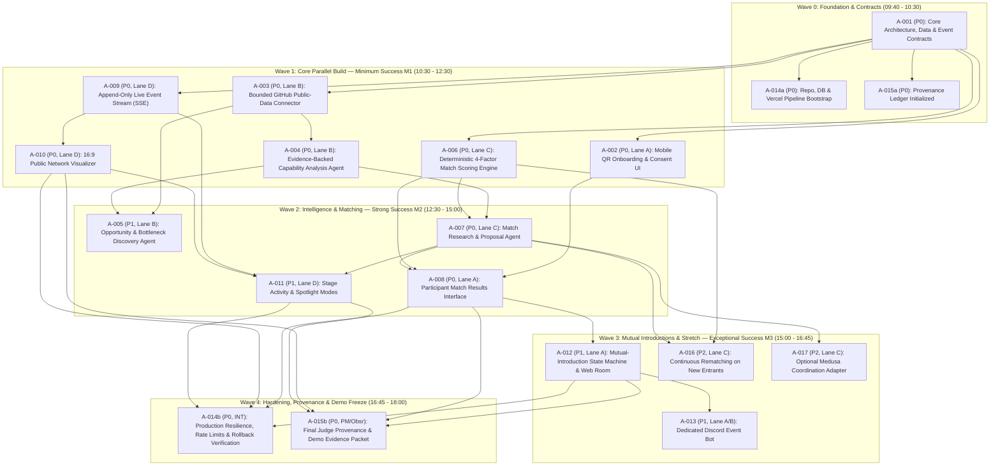

# Dependency DAG & Parallel Scheduling Plan — ARIADNE (`ARIADNE-HACK-2026`)

## 1. Full Issue Dependency Graph (`A-001` through `A-017`)

---

## 2. Critical Path Analysis

The **Critical Path to Minimum Success (`M1` at 12:30 PM)** is:
`A-001 (Contracts)` → `A-003 (GitHub Connector)` → `A-004 (Capability Analysis)` + `A-002 (QR Onboarding)` + `A-009/A-010 (Event Stream & Network Graph)`.

The **Critical Path to Strong Success (`M2` at 15:00 PM)** is:
`A-001` → `A-004` + `A-006 (Scoring Engine)` → `A-007 (Match Proposal Agent)` → `A-008 (Participant Match Results UI)`.

The **Critical Path to Exceptional Success (`M3` at 16:45 PM)** is:
`A-008` → `A-012 (Mutual-Introduction Workflow)` → `A-013 (Discord Event Bot)` + `A-011 (Spotlight Mode)`.

### Key Parallelization Unlock
Notice that in the raw dependency list, `A-006` (Match Scoring Engine) depends on `A-001` and `A-004`. Because `A-001` defines the exact `CapabilityClaim`, `OpportunityNeed`, and `EvidenceReceipt` TypeScript interfaces upfront in Wave 0, **Builder C (`Lane-C`) can build and unit-test 100% of `A-006` in Wave 1 against the `A-001` contract** in parallel with Builder B building `A-003`/`A-004`!

---

## 3. Wave-by-Wave Merge Order & Integration Gates

| Wave | Window (PST) | PR Merge Order (`I-Gate`) | Release Tag | Checkpoint Deliverable |
|---|---|---|---|---|
| **Wave 0** | `09:40–10:30` | 1. `A-001` (Contracts + DB Schema) 2. `A-014a` (Vercel + DB Bootstrap) 3. `A-015a` (Provenance Baseline) | `v0.0.1-contracts` | All 4 Builder lanes branch off `v0.0.1-contracts` with zero type ambiguity. |
| **Wave 1** | `10:30–12:30` | 1. `A-009` (Event Stream SSE) 2. `A-003` (GitHub Connector) 3. `A-006` (Match Scorer) 4. `A-002` (Onboarding UI) 5. `A-004` (Capability Agent) 6. `A-010` (Network Visualizer) | `v0.1.0-m1` (**Minimum Success**) | Live QR onboarding → GitHub fetch → grounded capability profile → node appears on 16:9 stage graph. |
| **Wave 2** | `12:30–15:00` | 1. `A-005` (Opportunity Discovery) 2. `A-007` (Match Proposal Agent) 3. `A-008` (Match Results UI) 4. `A-011` (Activity & Spotlight Views) | `v0.2.0-m2` (**Strong Success**) | End-to-end top-3 match generation with 4-factor breakdown, evidence links, and stage spotlighting. |
| **Wave 3** | `15:00–16:45` | 1. `A-012` (Mutual Intro State Machine + Web Room) 2. `A-016` (Continuous Rematching) 3. `A-013` (Discord Event Bot) 4. `A-017` (Optional Medusa Adapter) | `v0.3.0-m3` (**Exceptional Success**) | Mutual `Interested` approvals unlock private web room + Discord bot introduction + stage celebration animation. |
| **Wave 4** | `16:45–17:45` | 1. `A-014b` (Hardening & Smoke Verification) 2. `A-015b` (Judge Provenance Report) | `v1.0.0-hackathon` (**Demo Freeze**) | Production locked 15 minutes before judging (`17:45 PST`). |

---

## 4. Safe Deferral Shedding Ladder (If Behind Schedule)

If any wave slips by `> 25 minutes`, `Ariadne-PM` executes the following pre-authorized shedding order:
1. **First to Shed (`15:00` check):** `A-017` (Medusa Coordination Adapter — `P2 Optional`). Zero impact on user-facing product or stage demo.
2. **Second to Shed (`15:30` check):** `A-016` (Continuous Rematching — `P2`). Participants can click a manual *"Refresh Matches"* button on `/me` instead of background auto-rematch triggers.
3. **Third to Shed (`16:00` check):** `A-013` (Discord Event Bot — `P1`). `A-012` already includes the complete **Private Web Introduction Room** where mutually matched participants exchange contact info and starter prompts directly in the mobile web app.
4. **Fourth to Shed (Partial degradation):** `A-005` deep issue scraping falls back to repository description + topic + language opportunity inference so `A-006`/`A-007` remain fast and reliable.
