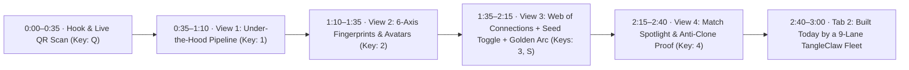

# Live Room Presentation & Monitor Script — ARIADNE (`ARIADNE-HACK-2026`)
*Tagline: Find Your Thread. · Monitor-First Interactive Pitch & Judge Runbook (10–20 Person Room Edition)*

> [!IMPORTANT]
> **Live Presentation URLs & Hotkeys (Bookmark on Presenter Laptop)**
> - **Monitor Tab 1 — 16:9 Stage Visualizer (`/stage/`):** [http://cursatory.tail123678.ts.net:3422/stage/](http://cursatory.tail123678.ts.net:3422/stage/)
> - **🎬 Split-Screen Automated Demo Theater (`/demo-theater` — Stage + Dual Phones):** [http://cursatory.tail123678.ts.net:3422/demo-theater](http://cursatory.tail123678.ts.net:3422/demo-theater) *(Auto-Play link: [http://cursatory.tail123678.ts.net:3422/demo-theater?autoplay=1](http://cursatory.tail123678.ts.net:3422/demo-theater?autoplay=1))*
> - **🎥 Pre-Recorded 1080p MP4 Judge Demo Video (`/demo-video.mp4`):** [http://cursatory.tail123678.ts.net:3422/demo-video.mp4](http://cursatory.tail123678.ts.net:3422/demo-video.mp4)
> - **Public QR Onboarding URL (Encoded in Stage QR Overlay `Q` & Floating QR `A`):** [https://cell-internationally-thermal-magnet.trycloudflare.com/join](https://cell-internationally-thermal-magnet.trycloudflare.com/join)
> - **Monitor Tab 2 — Public Roadmap (`16/16` Closed) & Certified Sprint Reports (`v0.1.0`–`v0.4.0`):** [https://jason-vaughan.github.io/Ariadne/](https://jason-vaughan.github.io/Ariadne/) & [https://jason-vaughan.github.io/Ariadne/reports/](https://jason-vaughan.github.io/Ariadne/reports/)
> - **Monitor Tab 3 (Backup / Instant Phone View) — 1-Click Mutual Intro Room:** [http://cursatory.tail123678.ts.net:3422/demo-intro](http://cursatory.tail123678.ts.net:3422/demo-intro)
> - **Monitor Tab 4 — Onsite Admin Capacity, Seed & Room Reset Controller (`/admin`):** [http://cursatory.tail123678.ts.net:3422/admin](http://cursatory.tail123678.ts.net:3422/admin)

---

## 1. Pre-Pitch Monitor Setup (2 Minutes Before You Speak)

1. **Put Browser Window on the External Monitor (`Full Screen` / `Cmd+Ctrl+F`):**
   - **Tab 1 (Active):** [http://cursatory.tail123678.ts.net:3422/stage/](http://cursatory.tail123678.ts.net:3422/stage/)
   - **Tab 2:** [https://jason-vaughan.github.io/Ariadne/reports/v0.4.0/](https://jason-vaughan.github.io/Ariadne/reports/v0.4.0/) (Certified `v0.4.0` Sprint Report)
   - **Tab 3:** [https://jason-vaughan.github.io/Ariadne/](https://jason-vaughan.github.io/Ariadne/) (Interactive Trains & Cars Roadmap)
2. **Initial Stage State on Tab 1 (`/stage/`):**
   - `/stage/` now opens **by default on View 1 (`1: Under-the-Hood Pipeline` — the 4-Column GitHub + Website Analyzer)** so the room immediately sees the live analyzer pipeline!
   - Confirm **`🌱 Seed AI Devs: OFF`** (so the room starts at `0` or only real room builders).
   - Press **`A`** to pop open the **draggable persistent Floating QR card (`📌 Floating QR`)** and drag it to the corner you like best—it stays on top across **all 4 Stage Views (`1`–`4`)** while people scan in! (Or press **`Q`** if you want the giant full-screen QR modal).
   - Every participant who scans in now defaults to showing their **real `@github_username` and GitHub avatar** (no `Warp-09E0` automated aliases unless someone explicitly unchecks stage display or you press `P`).
3. **Your Phone (In Your Hand):**
   - Open [https://cell-internationally-thermal-magnet.trycloudflare.com/join](https://cell-internationally-thermal-magnet.trycloudflare.com/join) (or pre-scan with your own GitHub username `Jason-Vaughan` so your avatar is the first node on the screen).

---

## 2. Stage Keyboard Hotkey Strip (Keep Under Your Left Hand)

| Key | Stage Action | When to Press It |
|---|---|---|
| **`A`** | Toggle **Draggable Persistent Floating QR** (`📌 Floating QR`) | **Keep `A` ON** throughout your talk! Drag it anywhere on the monitor—it floats on top of Views `1`, `2`, `3`, and `4` so latecomers can keep scanning while you switch views. |
| **`Q`** | Toggle giant **Full-Screen QR Modal** (`📱 QR Overlay`) | Optional full-screen QR splash for the first 15 seconds; press **`Q`** to close and leave **`A`** (Floating QR) pinned in the corner. |
| **`1`** | **View 1: Under-the-Hood Pipeline** *(Default Startup View)* | **Beat 1 (`0:30`):** Shows the 4 analyzer stages (`1 · GitHub + Website Crawl` → `2 · Evidence & Sanitizer` → `3 · 6-Axis Fingerprint` → `4 · Match Scorer & Golden Thread`) firing live with real `@github` handles. |
| **`2`** | **View 2: Builder Fingerprints** (Hexagonal Radar Grid) | **Beat 2 (`1:05`):** Show the room's 6-Axis radar charts, GitHub avatars (or green-dot fallbacks), and repo evidence citations. |
| **`3`** | **View 3: Web of Connections** (Force-Directed Graph + Golden Arcs) | **Beat 3 (`1:30`):** Show each builder's GitHub avatar node and their Top-3 complementary match threads. |
| **`S`** | Toggle **`🌱 Seed AI Devs: ON (+25)`** / `OFF` | **Beat 3 (`1:45`):** Press **`S`** on View 3 to weave the live room attendees into 25 pre-profiled SF AI builders in `< 10ms`! |
| **`4`** | **View 4: Match Spotlight** (`←` / `→` to step pairs) | **Beat 4 (`2:10`):** Inspect a specific pair's 5-component score breakdown (`35/30/15/10/10`) and AI collaboration thesis. |
| **`I`** or **`?`** | Toggle **Full-Screen Stage Explainer Modal** (`ℹ️ Info`) | Press **`I`** on any view (`1`, `2`, `3`, or `4`) to open a full-screen judge modal explaining the 6-Axis Fingerprint & Bounded Complementarity math (`35/30/15/10/10` + `38` Anti-Clone Cap). |
| **`Space`** | Toggle **Auto-Cycle** across Views `1 → 2 → 3 → 4` | Leave **OFF** while you narrate manually; turn **ON** during Q&A so the monitor cycles itself automatically while the `A` Floating QR stays on top. |
| **`P`** | Toggle **Stage Privacy Mode** (`Alias-Only` vs `@handle` + Avatar) | Press briefly if a judge asks about privacy/GDPR to show instant pseudonymization (`Thread-XXXX` + green dots). |
| **`🧹 Reset` Button** | **2-Click Room Reset** (Bottom HUD bar on `/stage/`, `/admin`, or `/demo-theater`) | Wipes all room participants, matches, claims, needs, receipts, and events back to **`0`** while keeping the GitHub snapshot cache warm for instant re-scans! |

---

## 3. Word-for-Word 3-Minute Room Presentation Script

### Beat 0 (`0:00 – 0:35`) · The Hook + Live Room QR Scan (`QR Modal Open`)
- **On Monitor:** `/stage/` with the **`📱 QR Overlay`** open (`Q`).
- **What You Say:**
  > *"Look around the room—we started with 40 builders today, and the hardest part of any hackathon or technical meetup isn't writing code, it's figuring out **which 2 or 3 people in this room** are building the exact missing half of your stack.*
  > *Usually you only find that out at 7 PM over drinks when it's too late.*
  > *So today we built **Ariadne — Find Your Thread**. Pull out your phone right now, scan this QR code on the monitor, type just your public GitHub username, and tap **Join**—no OAuth login, no password, no checkboxes, one tap. Watch what happens on the big screen."*
- **What You Do:** Watch the **`Builders Scanned In`** counter tick up on the QR modal for ~15 seconds, then press **`Q`** to close the QR modal and press **`1`**.

---

### Beat 1 (`0:35 – 1:10`) · View 1: Under-the-Hood Agentic Pipeline (`Press 1`)
- **On Monitor:** **View 1 (`1: Under-the-Hood Pipeline`)** showing live events flowing left-to-right across the 4 columns.
- **What You Say (Pointing at Columns 1 → 4 on the monitor):**
  > *"Here is what Ariadne is doing in real time as your phones hit our server:*
  > *1. **Column 1 (GitHub & Website Crawl):** Our bounded connector pulls your public repositories, languages, READMEs, and open issues in under 200 milliseconds—and grabs your GitHub profile photo.*
  > *2. **Column 2 (Two-Stage Capability & Bottleneck Agents):** We run a two-stage progressive pipeline. Stage 1 deterministically extracts your verified skills and project bottlenecks in under 500 milliseconds so your phone never waits on an LLM; Stage 2 then enriches those claims with Gemini Flash—and every single claim is locked to a real GitHub evidence receipt (`OBSERVED_FACT`, `SELF_REPORTED`, or `AI_INFERENCE`).*
  > *3. **Column 3 (6-Axis Builder Fingerprint):** It distills your engineering DNA across 6 axes—`Systems/Infra`, `Agent Orchestration`, `LLM/Eval`, `Frontend/UX`, `Product/GTM`, and `Data Pipelines`.*
  > *4. **Column 4 (Anti-Clone Matchmaking):** Instead of matching two identical backend engineers, our scorer penalizes clones (`>0.85` cosine similarity) and rewards **Need ↔ Offer complementarity**—when your repo bottleneck matches someone else's primary superpower."*

---

### Beat 2 (`1:10 – 1:35`) · View 2: 6-Axis Builder Fingerprints & GitHub Avatars (`Press 2`)
- **On Monitor:** **View 2 (`2: Builder Fingerprints`)** showing hexagonal radar cards for the people who just scanned in.
- **What You Say (Pointing at a live attendee's card on the monitor):**
  > *"Switch to **View 2**, and you can see everyone who just scanned in—with your GitHub profile photo right on your card (or a green dot if you don't have a photo or chose alias-only privacy). Each hexagon shows your strongest axis and the exact repository evidence receipts backing it."*

---

### Beat 3 (`1:35 – 2:15`) · View 3: Web of Connections, The `+25` Seed Move & The Golden Arc (`Press 3`, then `S`)
- **On Monitor:** **View 3 (`3: Web of Connections`)**.
- **What You Say:**
  > *"Now look at **View 3: The Web of Connections**. Every person in the room is a node with their GitHub avatar, connected only to their **Top-3 (`k=3`) highest-value complementary matches** so the graph never turns into a hairball.*
  > *And if you're running a smaller room of 10 or 15 people and want to see how the graph behaves at full conference scale—watch this."*
- **Action — Press `S` (`🌱 Seed AI Devs: ON (+25)`):**
  > *"With one keystroke (`S`), we inject **25 pre-profiled AI builder personas** into the live scoring pool. In under 10 milliseconds, the scorer re-evaluates the entire room and weaves everyone who scanned in today into a 30+ builder network."*
- **Action — Trigger or Point to a Golden Thread (Mutual Match):**
  > *"On your phone right now, you see your **Top-3 Match Cards**. Your contact info is completely private by default. When **both** builders tap **Interested** on each other, watch the monitor—their edge ignites into a **Golden Thread** (`⚡ NEW GOLDEN THREAD`), and their phones unlock a **Private Mutual Intro Room** with bilateral contact reveal, a 1-tap vCard download, an AI-generated 3-minute collaboration starter, and physical room locator pills like `'Near Stage'` or `'Coffee Area'` so you can walk over and meet right now."*

---

### Beat 4 (`2:15 – 2:40`) · View 4: Match Spotlight (`Press 4`)
- **On Monitor:** **View 4 (`4: Match Spotlight`)** (use `←` / `→` to step through pairs).
- **What You Say:**
  > *"In **View 4 (Match Spotlight)**, we can inspect any pair on the big screen: you see both builders side by side, their composite score out of 100, the exact 5-component bar breakdown (`Capability Similarity`, `Need ↔ Offer Fit`, `Complementarity`, `Novelty`, and `Freshness`), and the concrete 15-minute first collaboration they should try today."*

---

### Beat 5 (`2:40 – 3:00`) · How We Built It Today (`Switch to Tab 2: /reports/v0.4.0/ & Roadmap`)
- **On Monitor:** Switch to **Tab 2** ([https://jason-vaughan.github.io/Ariadne/reports/v0.4.0/](https://jason-vaughan.github.io/Ariadne/reports/v0.4.0/)) and **Tab 3** ([https://jason-vaughan.github.io/Ariadne/](https://jason-vaughan.github.io/Ariadne/)).
- **What You Say:**
  > *"One last thing for the judges: **how** was all of this built today?*
  > *Between this morning and 2 PM, we orchestrated a **9-lane autonomous agent fleet on TangleClaw**—1 PM coordinator, 4 parallel Builder lanes with strictly disjoint file envelopes (`Envelope(A) ∩ Envelope(B) = ∅`), an independent Architect gate, an independent PR Reviewer gate, a sole Integrator, and a Sprint Observer.*
  > *Across **4 release waves (`v0.1.0` → `v0.4.0`)**, the fleet closed **16 of 16 issues**, merged **22 pull requests**, and passed **528 automated tests** with zero merge conflicts—all audited in these live interactive `v2.0.0` Sprint Reports."*

---

## 4. Deep-Dive Q&A: How We Rate the 6 Axes & Score Matches ("Is It Elo?")

> [!TIP]
> **The 10-Second Answer to "Is There an Elo Rating Going On?":**
> *"No—Elo requires historical win/loss games over time, which fails at a 1-day hackathon because everyone enters at a **cold start**. Instead, Ariadne runs a **Two-Stage Evidence-Backed Vector & Complementarity Scoring Engine** that computes a deterministic `0–100` 6-Axis Builder Fingerprint in `<50ms` from your public repos, optionally allows Gemini 2.5 Flash to adjust any axis by at most **±25 points** when backed by repo receipts, and then scores pairs across **5 weighted complementarity components (`35 / 30 / 15 / 10 / 10`)** with a hard **Anti-Clone Penalty Gate**."*

### Part A — How a Builder's 6-Axis Radar Fingerprint (`0–100` per Axis) Is Computed
Every participant is scored `0–100` across 6 engineering axes:
1. **`Systems/Infra`** (`Go`, `Rust`, `C/C++`, `Docker`, `Kubernetes`, `Terraform`, distributed systems, infra/SRE)
2. **`Agent Orchestration`** (`MCP`, `LangGraph`, multi-agent swarms, tool-use, autonomous workflows, planners)
3. **`LLM/Eval`** (`PyTorch`, evals, benchmarks, RAG, fine-tuning, embeddings, prompt engineering)
4. **`Frontend/UX`** (`TypeScript`, `React`, `Next.js`, `Svelte`, `Swift`, design systems, UI/UX, WebGL/animation)
5. **`Product/GTM`** (shipped SaaS, growth, onboarding, roadmaps, founder/launch velocity, docs/MDX)
6. **`Data/Pipelines`** (`SQL`, `Kafka`, `Airflow`, `dbt`, `Spark`, `DuckDB`, ETL, streaming, scrapers/datasets)

**How each axis is rated (`src/github/connector.ts` & `src/intelligence/capability-agent.ts`):**
- **Stage 1 — Deep Multi-Signal Cold-Start Math (`<300ms`, Zero LLM Wait):**
  1. **Star-Weighted Repo Signal:** For each of your top **10** non-fork public repositories (`MAX_REPOS = 10`), we compute a repo weight `w = 1 + min(1, log10(1 + stars) / 2)` (ranging from `1.0x` to `2.0x`, never more than double).
  2. **Context-Aware Language & Taxonomy Routing (Superpower Disambiguation):**
     - Instead of naively treating every `TypeScript`/`JavaScript` repo as `Frontend/UX` or every repo mentioning `"AI"`/`"Claude"` as `LLM/Eval`, our analyzer inspects the repo's architecture context: CLI tools, MCP servers, `claude-code` workflows, and autonomous systems route directly to **`Agent Orchestration` + `Systems/Infra` + `Product/GTM`**, while **`LLM/Eval`** is reserved for true evaluation, benchmarking, RAG, fine-tuning, and ML inference work.
     - Builders with live deployed sites (`profile.blog` / repo `homepage`), `<username>/<username>` profile READMEs, and shipped user-facing apps/trackers/dashboards receive structural **`Product/GTM`** credit.
  3. **Capped Keyword Signals (Anti-Keyword-Stuffing):** We scan distinct domain keywords with strict per-source caps (`≤2`/repo, `≤4` README, `≤3` bio, `≤5` website) and map each raw axis sum through `score = round(100 * (1 - exp(-raw / 2.5)))`.
- **Stage 2 — Bounded Gemini 2.5 Flash Refinement (`±25` Guardrail):**
  - Gemini 2.5 Flash reads your flagship README and repo summaries to spot deeper architectural work (e.g. a TypeScript repo that is actually a distributed agent runtime).
  - **Hard Guardrail (`MAX_FINGERPRINT_SHIFT = 25`):** Stage 2 is **mathematically clamped to ±25 points** from the Stage 1 deterministic baseline on any axis, and every extracted `CapabilityClaim` must cite a real `evidence_receipt_id` (`primary` = ≥3 repos or ≥40% of repos; `active` = 2 repos; `exploratory` = 1 repo).

---

### Part B — How Two Builders Are Rated as a Match (`0–100` Composite Score)
Instead of matching two people who look identical, `src/matching/scorer.ts` scores every pair `(A, B)` using a **5-Component Weighted Formula**:

$$\text{Composite Score} = \text{round}\Big(100 \times \big(0.35\cdot\text{CapSim} + 0.30\cdot\text{NeedFit} + 0.15\cdot\text{Comp} + 0.10\cdot\text{Novelty} + 0.10\cdot\text{Freshness}\big)\Big)$$

| Weight | Component | How It Is Calculated |
|---|---|---|
| **`35%`** | **1. Capability Similarity (`capability_similarity`)** | Cosine similarity of Builder A and Builder B's confidence-and-proficiency-weighted capability vectors (`primary = 1.0`, `active = 0.7`, `exploratory = 0.4`) so they share enough common ground to collaborate immediately. |
| **`30%`** | **2. Bidirectional Need ↔ Offer Fit (`need_offer_fit`)** | Directional cosine similarity between what **Builder A needs** (extracted from open GitHub issues, README roadmap/TODO bottlenecks, or their stated `/join` goal) and what **Builder B offers** (`primary`/`active` capabilities weighted by confidence), averaged across both directions `(fit(A→B) + fit(B→A)) / 2`. Open issues older than 120 days are discounted by `0.2x`. |
| **`15%`** | **3. Architectural Complementarity (`complementarity`)** | **`1.0`** if one builder holds an architectural layer the other lacks (`Systems Architecture` ↔ `Framework/UI`, `Systems Architecture` ↔ `Tooling/Infra`, or `Agent Orchestration` ↔ `Evals/Observability`) **and** they share a domain tag; **`0.5`** for complementary layers without a shared domain; **`0.0`** otherwise. |
| **`10%`** | **4. Jaccard Novelty (`novelty`)** | **Jaccard distance** `1 - |A ∩ B| / |A ∪ B|` across both builders' distinct normalized capability sets (`0.0` when identical, `1.0` when completely distinct) — rewarding new skills the other person doesn't already have. |
| **`10%`** | **5. Evidence Freshness (`freshness`)** | Based on the median age of the latest push across both builders' cited repositories: `≤ 30 days → 1.0`, `≤ 90 days → 0.7`, `≤ 180 days → 0.4`, `> 180 days → 0.1`. |

- **The Hard Anti-Clone Penalty Gate (`src/matching/anti-clone.ts`):**
  - If two builders have **zero Need ↔ Offer fit (`need_offer_fit === 0`) AND zero Architectural Complementarity (`complementarity === 0`)** — i.e., pure clones who share skills without solving each other's bottlenecks or complementing layers — their composite score is **hard-capped at `38` (`ANTI_CLONE_CAP = 38`)**, which is strictly below the **`45` surfacing threshold** (`MATCH_SURFACE_THRESHOLD = 45`). They will never be surfaced as a match!

---

## 5. Fast Judge Q&A Cheat Sheet (System & Fleet Questions)

| Judge Question | Crisp 15-Second Answer |
|---|---|
| **"What happens if 100 people scan the QR code at the same second—doesn't GitHub rate-limit you or the LLM stall?"** | *"Three defenses: (1) Our GitHub connector rotates across a Multi-PAT pool (`5,000 req/hr` per token) with a 24-hour SQLite snapshot cache and VIP pre-warming; (2) our pipeline is **Two-Stage Progressive**—Stage 1 is 100% deterministic (`< 500ms`) so your phone gets a 6-axis fingerprint and Top-3 matches even if Gemini is completely offline; and (3) Stage 2 LLM explanations only run on the Top-3 (`k=3`) selected pairs, cutting $O(N^2)$ LLM calls by **96%**."* |
| **"How do you prevent LLM hallucinations when claiming someone knows Rust or Kubernetes?"** | *"Every `CapabilityClaim` and `OpportunityNeed` in our SQLite schema has a hard foreign-key-checked `evidence_receipt_ids` array (`>= 1` receipt required at the database constraint level) plus an epistemic badge (`OBSERVED_FACT`, `SELF_REPORTED`, or `AI_INFERENCE`). If the LLM invents a receipt ID that wasn't in the GitHub crawl, our validator rejects it and falls back to Stage 1."* |
| **"How do you handle privacy if someone doesn't want their GitHub handle on the big monitor?"** | *"Two-tier progressive identity: on `/join`, `stage_display_consent` is an explicit opt-in checkbox, and the presenter can also hit **`P`** on the stage monitor to flip the entire room into pseudonymous mode (`Thread-XXXX` + green dots). Contact cards are gated behind a bilateral state machine (`candidate → proposed_by_a/b → mutual_accepted`) and never appear in `/api/stage/snapshot`. Plus `/me` has a 1-tap `Withdraw & Delete My Data` button that cascades across SQLite and immediately removes your node from the stage."* |
| **"How did 4 coding agents work in parallel on one repo without stepping on each other?"** | *"We used TangleClaw's File-Collision Sorting Algorithm to partition all 15 MVP issues into **4 persistent parallel Trains** (`Track A` Mobile UX, `Track B` GitHub/Intelligence, `Track C` Scorer/Worker, `Track D` Stage Visualizer) where every wave's file envelopes are pairwise disjoint (`Envelope(A) ∩ Envelope(B) = ∅`). Every PR had to pass independent `R-Gate` (PR Reviewer), `A-Gate` (Architect), and `I-Gate` (Integrator) checks before squash-merging."* |

---

## 6. Emergency 1-Keystroke Recovery Moves During the Pitch

1. **If fewer than 3 people in the room scan the QR code:**
   - Press **`S`** on `/stage/` (`🌱 Seed AI Devs: ON (+25)`). All 25 realistic SF AI builder profiles hydrate and match with whoever scanned in within `< 10ms`.
2. **If you want to show an unlocked Mutual Intro Room immediately without waiting for two phones in the audience:**
   - Open **[http://cursatory.tail123678.ts.net:3422/demo-intro](http://cursatory.tail123678.ts.net:3422/demo-intro)** (or **[http://cursatory.tail123678.ts.net:3422/demo-me](http://cursatory.tail123678.ts.net:3422/demo-me)**) — it self-mints a pre-authenticated session and opens the unlocked bilateral Intro Room on the spot.
3. **If the public Cloudflare tunnel URL ever changes or resets:**
   - Run `launchctl kickstart -k gui/$(id -u)/com.ariadne.cloudflared` or open `/join` directly on the Tailscale link **[http://cursatory.tail123678.ts.net:3422/join](http://cursatory.tail123678.ts.net:3422/join)**.
